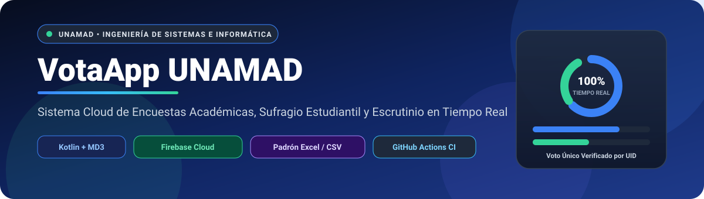
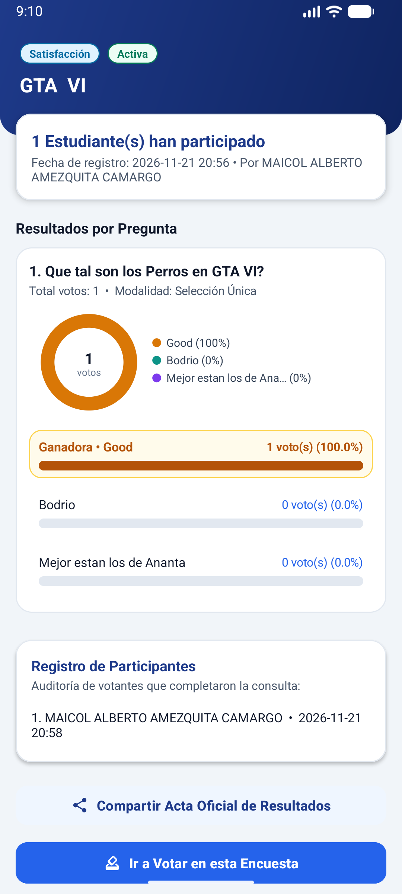
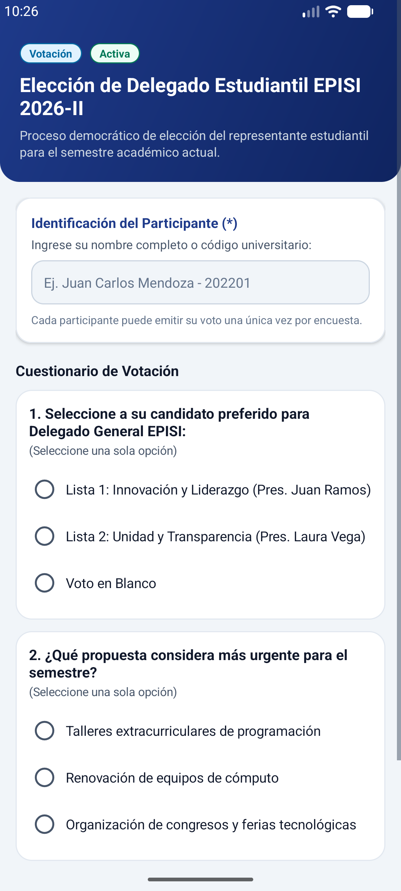
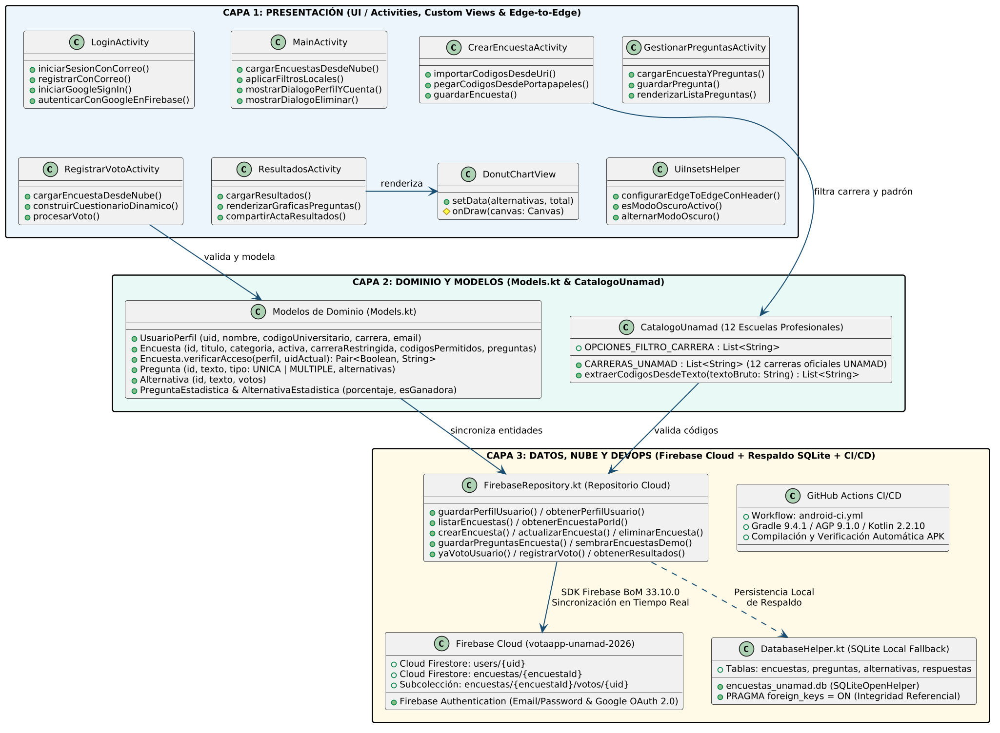

<div align="center">



<br/>

[](https://github.com/Maickel69/VotaApp-UNAMAD/actions/workflows/android-release.yml)
[](https://github.com/Maickel69/VotaApp-UNAMAD/releases/download/latest-apk/VotaApp-UNAMAD.apk)
[](releases/VotaApp-UNAMAD.apk)

[](https://kotlinlang.org/)
[](https://firebase.google.com/)
[](https://m3.material.io/)
[](https://developer.android.com/)

</div>

---

## Descarga e Instalación Directa (APK)

Puedes descargar el instalador compilado automáticamente por **GitHub Actions** desde cualquiera de estos dos enlaces:

- **Release Oficial (Auto-actualizable con GitHub Actions):** [**Descargar `VotaApp-UNAMAD.apk` (Latest Release)**](https://github.com/Maickel69/VotaApp-UNAMAD/releases/download/latest-apk/VotaApp-UNAMAD.apk)
- **Archivo APK dentro del repositorio:** [`releases/VotaApp-UNAMAD.apk`](releases/VotaApp-UNAMAD.apk)

> **Nota sobre actualizaciones sin reinstalar:** Todas las encuestas, preguntas, padrones de códigos estudiantiles, carreras UNAMAD y votos están sincronizados en tiempo real con **Google Cloud Firestore (`votaapp-unamad-2026`)**, por lo que los cambios de datos se reflejan al instante en todos los dispositivos sin necesidad de reinstalar el APK. Cuando se modifica el código fuente en `main`, el flujo [`.github/workflows/android-release.yml`](.github/workflows/android-release.yml) compila y actualiza automáticamente el APK en GitHub Releases.

---

## Características Principales

| Módulo | Descripción Técnica |
| :--- | :--- |
| **Autenticación Institucional & Google OAuth** | Inicio de sesión y registro con **Firebase Authentication** (Correo/Contraseña + **Google Sign-In**), recuperación de contraseña por correo y validación de código universitario único por estudiante (`users/{uid}`). |
| **Catálogo Oficial de 12 Carreras UNAMAD** | Selector precargado con las **12 Escuelas Profesionales de la UNAMAD** (*Ingeniería de Sistemas e Informática*, *Forestal*, *Agroindustrial*, *Veterinaria*, *Enfermería*, *Derecho*, *Educación*, *Ecoturismo*, *Administración*, *Contabilidad*) sin ingreso manual. |
| **Importación Masiva de Códigos (.TXT / .CSV / Excel)** | Restricción de encuestas por padrón estudiantil importando archivos `.txt` o `.csv` desde Excel/Bloc de Notas o pegando columnas directamente desde el portapapeles. |
| **Modo Oscuro Obsidian & Material Design 3** | Paleta tonal MD3 de 4 niveles (*Obsidian Midnight* `#090E1A` / `#121B2E`), cifras tabulares (`tnum`), íconos vectoriales SVG, tarjetas de votación interactivas y soporte completo Edge-to-Edge + IME. |
| **Escrutinio en Tiempo Real & Acta Compartible** | Gráfico circular animado (`DonutChartView`), barras de progreso animadas, auditoría de participantes con voto único (`encuestas/{id}/votos/{uid}`) y exportación de **Acta Oficial de Resultados**. |
| **CI/CD con GitHub Actions** | Pipeline automatizado que ejecuta pruebas unitarias (`testDebugUnitTest`), compila el APK (`assembleDebug`) y publica el binario actualizado en **GitHub Releases** en cada `push` a `main`. |

---

## Galería Visual de la Aplicación

<div align="center">
<table>
  <tr>
    <td align="center"><b>Panel Principal & Encuestas</b></td>
    <td align="center"><b>Escrutinio con Gráfico Donut</b></td>
    <td align="center"><b>Cédula de Votación</b></td>
  </tr>
  <tr>
    <td></td>
    <td></td>
    <td></td>
  </tr>
</table>
</div>

---

## Arquitectura del Sistema

<div align="center">
  
</div>

### Estructura del Proyecto

```text
VotaApp-UNAMAD/
├── .github/workflows/
│   └── android-release.yml          # Pipeline CI/CD: Test + Build APK + Auto-Release
├── app/
│   ├── google-services.json         # Configuración Firebase (votaapp-unamad-2026)
│   └── src/main/
│       ├── java/com/example/proyectofinal/
│       │   ├── LoginActivity.kt             # Auth Firebase + Google Sign-In + Modo Oscuro
│       │   ├── MainActivity.kt              # Dashboard KPI + Buscador + Filtros + Perfil UNAMAD
│       │   ├── CrearEncuestaActivity.kt     # CRUD Encuestas + Filtro Carrera + Importador TXT/CSV
│       │   ├── GestionarPreguntasActivity.kt# CRUD Preguntas y Alternativas en Firestore
│       │   ├── RegistrarVotoActivity.kt     # Cédula de Voto Único verificado por UID y Código
│       │   ├── ResultadosActivity.kt        # Escrutinio en tiempo real + Acta compartible
│       │   ├── DonutChartView.kt            # Vista personalizada Canvas con animación
│       │   ├── FirebaseRepository.kt        # Capa de datos Cloud Firestore + Auth
│       │   ├── Models.kt                    # Modelos y Catálogo de 12 Carreras UNAMAD
│       │   └── UiInsetsHelper.kt            # Edge-to-Edge, IME Insets y Persistencia de Tema
│       └── res/                             # Layouts MD3, Vector Drawables y Temas DayNight
├── releases/
│   └── VotaApp-UNAMAD.apk           # APK compilado listo para instalar en Android
├── Documentacion/                   # Informe Técnico (.docx / .pdf), Presentación (.pptx) y Diagramas
└── firestore.rules                  # Reglas de Seguridad desplegadas en Cloud Firestore
```

---

## Créditos Académicos — UNAMAD

- **Universidad:** Universidad Nacional Amazónica de Madre de Dios (UNAMAD)
- **Facultad / Escuela:** Facultad de Ingeniería — Escuela Profesional de Ingeniería de Sistemas e Informática
- **Docente:** Ing. Laura Salvatierra, Leonel Christofher
- **Autores:**
  - **Amezquita Camargo, Maicol Alberto**
  - **Torres Saire, Bickmer Fabricio**
